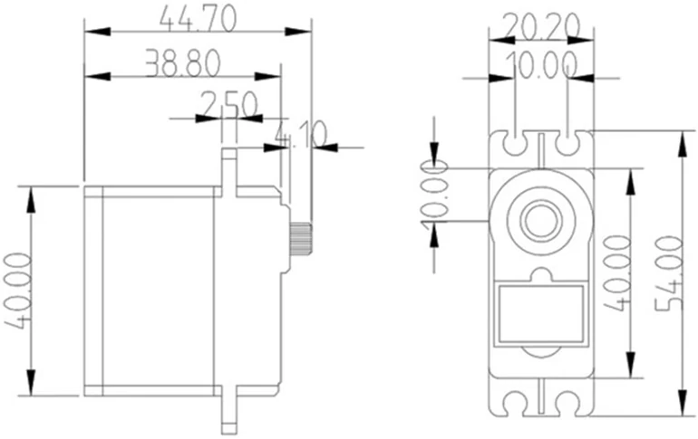

<div dir="auto">
<h1 dir="auto">🇺🇸 / 🇵🇱 C5ISR Tactical Node — Mechanical Enclosure (Rev 1.2)</h1>
</div>

This directory contains the production-ready 2D CAM laser cutting vector profiles and mechanical specifications for the ruggedized, outdoor C5ISR acoustic/optical observation node enclosure.

👉 **[REGISTRATION](https://officina-ferraria.github.io/OFFICINA-FERRARIA/#Rejestracja)**

<details>
<summary>🇵🇱 [Kliknij Trójkąt Po Lewej Stronie Aby Rozwinąć Opis w Języku Polskim]</summary>

<div dir="auto">
<h1 dir="auto">🇵🇱 Węzeł Taktyczny C5ISR — Obudowa Mechaniczna (Rev 1.2)</h1>
</div>
Ten katalog zawiera gotowe do produkcji profile wektorowe CAM 2D do cięcia laserowego oraz specyfikacje mechaniczne dla wzmocnionej, zewnętrznej obudowy węzła obserwacji akustyczno-optycznej C5ISR.
<br><br>

👉 **[REJESTRACJA](https://officina-ferraria.github.io/OFFICINA-FERRARIA/#Rejestracja)**

</details>

---

<div dir="auto">
<h2 dir="auto">🇺🇸 / 🇵🇱 Hardware Components & Financial Transparency / Zamówione Podzespoły i Transparentność Finansowa</h2>
</div>

The core hardware components for this node have been successfully ordered and paid for. For full transparency, the raw PDF confirmations are available directly in this repository:
* 📄 [Kamami_2026-11-07.pdf](./Kamami_2026-11-07.pdf) - Order confirmation.
* 📄 [statement_202631200044149.pdf](./statement_202631200044149.pdf) - Paysafecard payment statement.

The mechanical enclosure components have been quoted and fabricated by PlasticExpress. For full financial transparency, the manufacturing and transaction documents are available below:
* 📄 [wycena10382.pdf](./wycena10382.pdf) - Laser cutting quote.
* 📄 [FSPE202611266.pdf](./FSPE202611266.pdf) - VAT Invoice from Contra Sp. z o.o.
* 📄 [statement_202631300096025.pdf](./statement_202631300096025.pdf) - Paysafecard payment statement.

<div dir="auto">
<h3 dir="auto">🛒 How to order</h3>
</div>

To automatically add the quoted enclosure components to your cart, click the **ORDER** link below (you must be logged into the PlasticExpress platform first).

👉 **[ORDER ENCLOSURE](https://plasticexpress.pl/wycena/Qb2gM/a)**

> **⚠️ IMPORTANT ORDER NOTE:**
> In the order notes section on the website, you **must** include the link to the updated SVG file:
> 🔗 
>
>```
>https://github.com/OFFICINA-FERRARIA/OFFICINA-FERRARIA/blob/main/hardware/enclosure/C5ISR_Node_Enclosure_FlatPattern_PMMA-4mm_Rev1.2.svg?short_path=7bf3152
>```
>
> **Why is this important?**
> The servo cutout was shifted by 10 mm after dimensional verification to ensure the servo drive axis perfectly aligns with the rod placed in the bearing.
<br>

**Project Bill of Materials (BOM) & Costs** (Exchange rates via NBP, 2026-11-13: 1 USD = 3.99 PLN | 1 EUR = 4.41 PLN)

| Qty | Component | Unit Price (PLN) | Total (PLN) | Total (USD) | Total (EUR) |
| :--- | :--- | :--- | :--- | :--- | :--- |
| 1 | [Servo MG996R](https://kamami.pl/serwa-giant/204180-servo-mg996r-5906623440627.html) | 19.54 zł | 19.54 zł | $4.90 | €4.43 |
| 1 | [XIAO ESP32S3 & Wio-SX1262 Kit (Meshtastic/LoRa)](https://kamami.pl/meshtastic/1194474-xiao-esp32s3-wio-sx1262-kit-zestaw-z-modulem-esp32s3-i-komunikacja-lora.html) | 62.16 zł | 62.16 zł | $15.58 | €14.10 |
| 2 | USB-A to USB-C Cable (1m, Black) | 5.08 zł | 10.16 zł | $2.55 | €2.30 |
| 1 | USB-C Adapter M-F (Angled, Side) | 9.16 zł | 9.16 zł | $2.30 | €2.08 |
| 1 | [Laser-cut PMMA Enclosure (PlasticExpress)](https://plasticexpress.pl/wycena/Qb2gM/a) | 71.34 zł | 71.34 zł | $17.88 | €16.18 |
| - | Shipping (Kamami - InPost Paczkomat) | - | 13.90 zł | $3.48 | €3.15 |
| - | Shipping (PlasticExpress - GLS) | - | 20.00 zł | $5.01 | €4.54 |
| **-** | **TOTAL PAID** | **-** | **206.26 zł** | **$51.69** | **€46.77** |

<details>
<summary>🇵🇱 [Kliknij Trójkąt Po Lewej Stronie Aby Rozwinąć Opis w Języku Polskim]</summary>
<br>

Kluczowe podzespoły sprzętowe dla tego węzła zostały pomyślnie zamówione i opłacone. W ramach pełnej transparentności finansowej projektu, surowe pliki PDF potwierdzające transakcję i wydatki zostały opublikowane bezpośrednio w tym repozytorium:
* 📄 [Kamami_2026-11-07.pdf](./Kamami_2026-11-07.pdf) - Potwierdzenie zamówienia.
* 📄 [statement_202631200044149.pdf](./statement_202631200044149.pdf) - Wyciąg płatności z konta Paysafecard.

Elementy mechaniczne obudowy zostały wycenione i wyprodukowane przez PlasticExpress. W ramach pełnej transparentności finansowej, dokumenty produkcyjne i transakcyjne są dostępne poniżej:
* 📄 [wycena10382.pdf](./wycena10382.pdf) - Oferta cięcia laserowego.
* 📄 [FSPE202611266.pdf](./FSPE202611266.pdf) - Faktura VAT (Contra Sp. z o.o.).
* 📄 [statement_202631300096025.pdf](./statement_202631300096025.pdf) - Wyciąg płatności Paysafecard.

<div dir="auto">
<h3 dir="auto">🛒 Jak zamówić</h3>
</div>

Aby automatycznie dodać wycenione elementy obudowy do koszyka, kliknij poniższy przycisk **ZAMÓW** (wymagane jest wcześniejsze zalogowanie na platformie PlasticExpress).

👉 **[ZAMÓW OBUDOWĘ](https://plasticexpress.pl/wycena/Qb2gM/a)**

> **⚠️ WAŻNA UWAGA DO ZAMÓWIENIA:**
> W polu uwag do zamówienia na stronie należy **bezwzględnie załączyć link** do zaktualizowanego pliku SVG:
> 🔗 
>
>```
>https://github.com/OFFICINA-FERRARIA/OFFICINA-FERRARIA/blob/main/hardware/enclosure/C5ISR_Node_Enclosure_FlatPattern_PMMA-4mm_Rev1.2.svg?short_path=7bf3152
>```
>
> **Dlaczego to ważne?**
> Otwór na serwo został przesunięty o 10 mm po korekcie i zweryfikowaniu wymiarów, aby oś napędu serwa idealnie zgadzała się z prętem umieszczonym w łożysku.

**Zestawienie kosztów podzespołów** (Średni kurs NBP z dn. 2026-11-13: 1 USD = 3,99 PLN | 1 EUR = 4,41 PLN)

| Ilość | Podzespół | Cena jedn. (PLN) | Suma (PLN) | Suma (USD) | Suma (EUR) |
| :--- | :--- | :--- | :--- | :--- | :--- |
| 1 | [Serwo MG996R](https://kamami.pl/serwa-giant/204180-servo-mg996r-5906623440627.html) | 19,54 zł | 19,54 zł | $4.90 | €4.43 |
| 1 | [Zestaw XIAO ESP32S3 & Wio-SX1262 Kit (Meshtastic/LoRa)](https://kamami.pl/meshtastic/1194474-xiao-esp32s3-wio-sx1262-kit-zestaw-z-modulem-esp32s3-i-komunikacja-lora.html) | 62,16 zł | 62,16 zł | $15.58 | €14.10 |
| 2 | Przewód USB typ A - USB typ C (1m, czarny) | 5,08 zł | 10,16 zł | $2.55 | €2.30 |
| 1 | Adapter USB typu C M-F (kątowy boczny) | 9,16 zł | 9,16 zł | $2.30 | €2.08 |
| 1 | [Obudowa PMMA cięta laserowo (PlasticExpress)](https://plasticexpress.pl/wycena/Qb2gM/a) | 71,34 zł | 71,34 zł | $17.88 | €16.18 |
| - | Wysyłka (Kamami - Paczkomat InPost) | - | 13,90 zł | $3.48 | €3.15 |
| - | Wysyłka (PlasticExpress - Kurier GLS) | - | 20,00 zł | $5.01 | €4.54 |
| **-** | **ZAPŁACONO W SUMIE** | **-** | **206,26 zł** | **$51.69** | **€46.77** |

</details>

---

<div dir="auto">
<h2 dir="auto">🇺🇸 / 🇵🇱 1. Manufacturing Profile Overview / Przegląd Profilu Produkcyjnego</h2>
</div>


*   **Source File:** `C5ISR_Node_Enclosure_FlatPattern_PMMA-4mm_Rev1.2.svg`
*   **Scale:** 1:1 (True Metric, Millimeters)
*   **Cutting Process:** Industrial CO2 / Fiber Laser CNC
*   **Target Hardware Compatibility:** Samsung Galaxy XCover 5 (Strict tolerance for dual-camera optical shroud alignment and internal clearance)

<details>
<summary>🇵🇱 [Kliknij Trójkąt Po Lewej Stronie Aby Rozwinąć Opis w Języku Polskim]</summary>
<br>

*   **Plik Źródłowy:** `C5ISR_Node_Enclosure_FlatPattern_PMMA-4mm_Rev1.2.svg`
*   **Skala:** 1:1 (Rzeczywiste wymiary metryczne, milimetry)
*   **Proces Cięcia:** Przemysłowy laser CNC CO2 / Fiber
*   **Kompatybilność Sprzętowa:** Samsung Galaxy XCover 5 (Ścisła tolerancja dla osłony optycznej podwójnego aparatu i wewnętrznego luzu)

</details>

---

<div dir="auto">
<h2 dir="auto">🇺🇸 / 🇵🇱 2. Material Specifications & Fabrication Notes / Specyfikacja Materiałowa</h2>
</div>

| Parameter | Specification | Notes |
| :--- | :--- | :--- |
| **Material** | PMMA GS (Cast Acrylic / Plexiglas) | **Cast only.** Do not substitute with extruded (XT) acrylic due to chemical solvent crazing and thermal stress cracking. |
| **Sheet Thickness** | 4.0 mm ($\pm 0.3$ mm tolerance) | Structural walls, top/bottom bulkheads, internal servo partition shelf. |
| **Color / Finish** | Optically clear (high transmission) | Ensures unhindered optical path for primary and secondary image sensors. |
| **Kerf Compensation** | Nominal: 0.15 – 0.20 mm | Integrated in vector stroke paths for interference fit where applicable. |

<details>
<summary>🇵🇱 [Kliknij Trójkąt Po Lewej Stronie Aby Rozwinąć Opis w Języku Polskim]</summary>
<br>

| Parametr | Specyfikacja | Uwagi |
| :--- | :--- | :--- |
| **Materiał** | PMMA GS (Szkło akrylowe wylewane / Plexiglas) | **Tylko wylewane.** Nie zastępować akrylem wytłaczanym (XT) ze względu na ryzyko mikropęknięć od rozpuszczalników i naprężeń termicznych. |
| **Grubość Arkusza** | 4,0 mm (tolerancja $\pm 0,3$ mm) | Ściany konstrukcyjne, górne/dolne grodzie, wewnętrzna półka na serwo. |
| **Kolor / Wykończenie** | Optycznie przezroczysty (wysoka transmisja) | Zapewnia niezakłóconą ścieżkę optyczną dla głównego i dodatkowego obiektywu. |
| **Kompensacja Rzazu** | Nominalnie: 0,15 – 0,20 mm | Zintegrowana w ścieżkach wektorowych dla ciasnego spasowania tam, gdzie to konieczne. |

</details>

---

<div dir="auto">
<h2 dir="auto">🇺🇸 / 🇵🇱 3. Mechanical Interface & Features / Interfejs Mechaniczny</h2>
</div>

*   **Primary Suspension (Top Plate):** Center cut-out designed for an integrated F608 flanged bearing carrying an M8 structural threaded rod / dynamic pivot axis.
*   **Internal Drive Partition:** Direct cut-outs for MG996R continuous-rotation/metal-gear servo and brass standoffs for the ESP32 processing unit.


<br>
Super Source: https://make.net.za/product/mg996r-servo-motor-analog-180-degrees

*   **Thermal Management:** Side wall cut-out sized for a passively cooled, finned extruded aluminum heatsink interface.
*   **Acoustic & Environmental Ports:**
    *   Dual offset ePTFE micro-porous acoustic vent membranes (waterproof / vapor-permeable).
    *   Bottom offset M12 IP68 cable gland port for strain-relieved coiled USB-C umbilical harness.
*   **Center-of-Gravity (CoG) Ballast Attachment:** Dual bottom-corner anchor points for M4/M5 eye bolts and carabiner rigging, carrying an external counterweight tactical battery pouch.

<details>
<summary>🇵🇱 [Kliknij Trójkąt Po Lewej Stronie Aby Rozwinąć Opis w Języku Polskim]</summary>
<br>

*   **Główne Zawieszenie (Górna Płyta):** Środkowe wycięcie zaprojektowane dla zintegrowanego łożyska kołnierzowego F608 opierającego pręt gwintowany M8 / dynamiczną oś obrotu.
*   **Wewnętrzna Przegroda Napędowa:** Bezpośrednie wycięcia pod serwo MG996R z metalową przekładnią i mosiężne dystanse dla jednostki ESP32.


<br>
Super Source: https://make.net.za/product/mg996r-servo-motor-analog-180-degrees

*   **Zarządzanie Termiczne:** Wycięcie w bocznej ściance dostosowane pod pasywnie chłodzony radiator z tłoczonego aluminium.
*   **Porty Akustyczne i Środowiskowe:**
    *   Dwie asymetryczne mikroporowate membrany akustyczne ePTFE (wodoodporne / przepuszczające parę).
    *   Dolny port pod dławnicę kablową M12 (IP68) dla zabezpieczonego spiralnego przewodu zasilającego USB-C.
*   **Balast Środka Ciężkości (CoG):** Dwa dolne punkty kotwiczące pod śruby z uchem M4/M5 i karabińczyki, przenoszące zewnętrzną taktyczną kieszeń na powerbank stanowiącą przeciwwagę.

</details>

---

<div dir="auto">
<h2 dir="auto">🇺🇸 / 🇵🇱 4. Assembly & Joining Procedures / Procedury Montażu</h2>
</div>

1.  **Edge Preparation:** Remove protective masking along joint interfaces. Clean bonding faces with isopropanol (IPA) or anti-static cleaner.
2.  **Solvent Welding:** Assemble perpendicular joints using capillary-action solvent cement (e.g., Acrifix 116 / 192 or equivalent PMMA solvent). Ensure full chemical cross-linking.
3.  **Internal Fastener Blocks:** Layered internal structural corner blocks ($15 \times 15$ mm, laminated from offcut PMMA) host heat-set brass threaded inserts (M3) for front service-hatch retention.

<details>
<summary>🇵🇱 [Kliknij Trójkąt Po Lewej Stronie Aby Rozwinąć Opis w Języku Polskim]</summary>
<br>

1.  **Przygotowanie Krawędzi:** Usuń folię ochronną wzdłuż powierzchni łączeń. Oczyść powierzchnie klejenia izopropanolem (IPA) lub płynem antystatycznym.
2.  **Klejenie Rozpuszczalnikowe:** Złóż złącza prostopadłe używając kleju kapilarnego (np. Acrifix 116 / 192 lub odpowiednika dla PMMA). Upewnij się, że zaszło pełne sieciowanie chemiczne.
3.  **Wewnętrzne Bloki Montażowe:** Warstwowe, wewnętrzne narożne bloki konstrukcyjne ($15 \times 15$ mm, laminowane ze ścinek PMMA) mieszczą wtopione mosiężne gwinty (M3) do mocowania przedniej klapy serwisowej.

</details>

---

<div dir="auto">
<h2 dir="auto">🇺🇸 / 🇵🇱 5. Raw Vector Data (`.svg`)</h2>
</div>

```svg
<svg xmlns="http://www.w3.org/2000/svg" width="600mm" height="400mm" viewBox="0 0 600 400">
  <g stroke="#dc143c" stroke-width="0.5" fill="none">
    
    <!-- 1. DEKIEL GÓRNY (128x88 mm) -->
    <rect x="10" y="10" width="128" height="88" />
    <circle cx="74" cy="54" r="11" stroke="#dc143c" /> <!-- Otwór na łożysko 608 -->

    <!-- 2. DEKIEL DOLNY (128x88 mm) -->
    <rect x="150" y="10" width="128" height="88" />
    <circle cx="174" cy="54" r="2" stroke="#dc143c" /> <!-- Lewy otwór na hak M4 -->
    <circle cx="254" cy="54" r="2" stroke="#dc143c" /> <!-- Prawy otwór na hak M4 -->
    <circle cx="214" cy="34" r="5" stroke="#dc143c" /> <!-- Dolna membrana ePTFE -->
    <circle cx="214" cy="74" r="6" stroke="#dc143c" /> <!-- Przepust kablowy / Dławnica M12 -->

    <!-- 3. WEWNĘTRZNA PÓŁKA NOŚNA NA SERWO (120x80 mm) -->
    <rect x="290" y="10" width="120" height="80" />
    <rect x="319.5" y="40" width="41" height="20" stroke="#dc143c" /> <!-- Wycięcie na serwo MG996R -->
    <line x1="340" y1="40" x2="340" y2="60" stroke="#dc143c" /> <!-- Podział odpadu na 2 chwytaki (20x20.5 mm) -->
    <path d="M 319.5 45 L 333 45 L 333 55 L 319.5 55" stroke="#dc143c" /> <!-- Chwytak lewy (obrócony 90°): szczelina 10x13.5 mm -->
    <path d="M 360.5 45 L 347 45 L 347 55 L 360.5 55" stroke="#dc143c" /> <!-- Chwytak prawy (obrócony 90°): szczelina 10x13.5 mm -->
    <circle cx="315.25" cy="45" r="1.75" stroke="#dc143c" /> <!-- Otwory M3 pod serwo (rozstaw 49.5 x 10 mm) -->
    <circle cx="315.25" cy="55" r="1.75" stroke="#dc143c" />
    <circle cx="364.75" cy="45" r="1.75" stroke="#dc143c" />
    <circle cx="364.75" cy="55" r="1.75" stroke="#dc143c" />
    
    <!-- Pasek 120x8 mm pod półką (8 klocków 15x8 mm, wspólne linie cięcia, odsunięty po 6 mm od półki i pleców) -->
    <line x1="305" y1="96" x2="305" y2="104" stroke="#dc143c" />
    <line x1="320" y1="96" x2="320" y2="104" stroke="#dc143c" />
    <line x1="335" y1="96" x2="335" y2="104" stroke="#dc143c" />
    <line x1="350" y1="96" x2="350" y2="104" stroke="#dc143c" />
    <line x1="365" y1="96" x2="365" y2="104" stroke="#dc143c" />
    <line x1="380" y1="96" x2="380" y2="104" stroke="#dc143c" />
    <line x1="395" y1="96" x2="395" y2="104" stroke="#dc143c" />
    <rect x="290" y="96" width="120" height="8" stroke="#dc143c" />

    <!-- 4. FASADA FRONTOWA / KLAPA REWIZYJNA (260x128 mm) -->
    <rect x="10" y="110" width="260" height="128" />
    <circle cx="16" cy="116" r="1.75" stroke="#dc143c" /> <!-- Otwory M3 -->
    <circle cx="264" cy="116" r="1.75" stroke="#dc143c" />
    <circle cx="16" cy="232" r="1.75" stroke="#dc143c" />
    <circle cx="264" cy="232" r="1.75" stroke="#dc143c" />

    <!-- 5. ŚCIANKA TYLNA (260x128 mm) -->
    <rect x="290" y="110" width="260" height="128" />
    <circle cx="296" cy="116" r="1.75" stroke="#dc143c" /> <!-- Otwory M3 -->
    <circle cx="544" cy="116" r="1.75" stroke="#dc143c" />
    <circle cx="296" cy="232" r="1.75" stroke="#dc143c" />
    <circle cx="544" cy="232" r="1.75" stroke="#dc143c" />

    <!-- 6. ŚCIANKA BOCZNA LEWA - PEŁNA (260x80 mm) -->
    <rect x="10" y="250" width="260" height="80" />

    <!-- 7. ŚCIANKA BOCZNA PRAWA Z RADIATOREM (260x80 mm) -->
    <rect x="290" y="250" width="260" height="80" />
    <rect x="370" y="270" width="100" height="40" stroke="#dc143c" /> <!-- Wycięcie na radiator -->
    <!-- Siatka 6x2 = 12 kwadracików 15x15 mm (wspólne linie cięcia, ramka 5 mm) -->
    <line x1="390" y1="275" x2="390" y2="305" stroke="#dc143c" />
    <line x1="405" y1="275" x2="405" y2="305" stroke="#dc143c" />
    <line x1="420" y1="275" x2="420" y2="305" stroke="#dc143c" />
    <line x1="435" y1="275" x2="435" y2="305" stroke="#dc143c" />
    <line x1="450" y1="275" x2="450" y2="305" stroke="#dc143c" />
    <line x1="375" y1="290" x2="465" y2="290" stroke="#dc143c" />
    <rect x="375" y="275" width="90" height="30" stroke="#dc143c" />

  </g>
</svg>
```