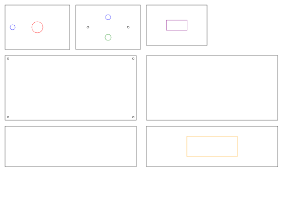
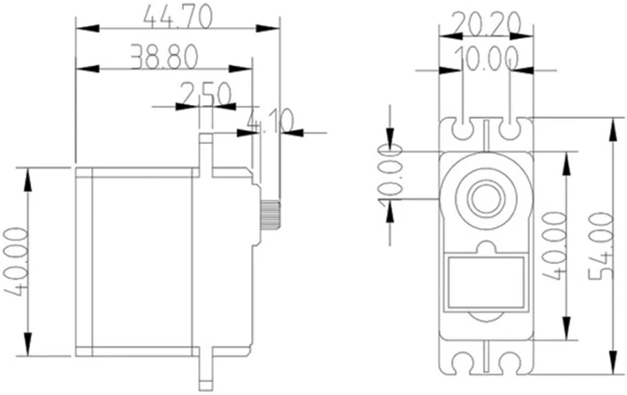

<div dir="auto">
<h1 dir="auto">🇺🇸 / 🇵🇱 C5ISR Tactical Node — Mechanical Enclosure (Rev 1.2)</h1>
</div>

This directory contains the production-ready 2D CAM laser cutting vector profiles and mechanical specifications for the ruggedized, outdoor C5ISR acoustic/optical observation node enclosure.

<details>
<summary>🇵🇱 [Kliknij Trójkąt Po Lewej Stronie Aby Rozwinąć Opis w Języku Polskim]</summary>

<div dir="auto">
<h1 dir="auto">🇵🇱 Węzeł Taktyczny C5ISR — Obudowa Mechaniczna (Rev 1.2)</h1>
</div>
Ten katalog zawiera gotowe do produkcji profile wektorowe CAM 2D do cięcia laserowego oraz specyfikacje mechaniczne dla wzmocnionej, zewnętrznej obudowy węzła obserwacji akustyczno-optycznej C5ISR.

</details>

---

<div dir="auto">
<h2 dir="auto">🇺🇸 / 🇵🇱 Hardware Components & Financial Transparency / Zamówione Podzespoły i Transparentność Finansowa</h2>
</div>

The core hardware components for this node have been successfully ordered and paid for. For full transparency, the raw PDF confirmations are available directly in this repository:
* 📄 [Kamami_2026-11-07.pdf](./Kamami_2026-11-07.pdf) - Order confirmation.
* 📄 [statement_202631200044149.pdf](./statement_202631200044149.pdf) - Paysafecard payment statement.

**Project Bill of Materials (BOM) & Costs** (Exchange rates via NBP, 2026-11-06: 1 USD = 3.93 PLN | 1 EUR = 4.39 PLN)

| Qty | Component | Unit Price (PLN) | Total (PLN) | Total (USD) | Total (EUR) |
| :--- | :--- | :--- | :--- | :--- | :--- |
| 1 | [Servo MG996R](https://kamami.pl/serwa-giant/204180-servo-mg996r-5906623440627.html) | 19.54 zł | 19.54 zł | $4.97 | €4.45 |
| 1 | [XIAO ESP32S3 & Wio-SX1262 Kit (Meshtastic/LoRa)](https://kamami.pl/meshtastic/1194474-xiao-esp32s3-wio-sx1262-kit-zestaw-z-modulem-esp32s3-i-komunikacja-lora.html) | 62.16 zł | 62.16 zł | $15.82 | €14.16 |
| 2 | USB-A to USB-C Cable (1m, Black) | 5.08 zł | 10.16 zł | $2.59 | €2.31 |
| 1 | USB-C Adapter M-F (Angled, Side) | 9.16 zł | 9.16 zł | $2.33 | €2.09 |
| - | Shipping (InPost Paczkomat) | - | 13.90 zł | $3.54 | €3.17 |
| **-** | **TOTAL PAID** | **-** | **114.92 zł** | **$29.24** | **€26.18** |

<details>
<summary>🇵🇱 [Kliknij Trójkąt Po Lewej Stronie Aby Rozwinąć Opis w Języku Polskim]</summary>
<br>
Kluczowe podzespoły sprzętowe dla tego węzła zostały pomyślnie zamówione i opłacone. W ramach pełnej transparentności finansowej projektu, surowe pliki PDF potwierdzające transakcję i wydatki zostały opublikowane bezpośrednio w tym repozytorium:
* 📄 [Kamami_2026-11-07.pdf](./Kamami_2026-11-07.pdf) - Potwierdzenie zamówienia.
* 📄 [statement_202631200044149.pdf](./statement_202631200044149.pdf) - Wyciąg płatności z konta Paysafecard.

**Zestawienie kosztów podzespołów** (Średni kurs NBP z dn. 2026-11-06: 1 USD = 3,93 PLN | 1 EUR = 4,39 PLN)

| Ilość | Podzespół | Cena jedn. (PLN) | Suma (PLN) | Suma (USD) | Suma (EUR) |
| :--- | :--- | :--- | :--- | :--- | :--- |
| 1 | [Serwo MG996R](https://kamami.pl/serwa-giant/204180-servo-mg996r-5906623440627.html) | 19,54 zł | 19,54 zł | $4.97 | €4.45 |
| 1 | [Zestaw XIAO ESP32S3 & Wio-SX1262 Kit (Meshtastic/LoRa)](https://kamami.pl/meshtastic/1194474-xiao-esp32s3-wio-sx1262-kit-zestaw-z-modulem-esp32s3-i-komunikacja-lora.html) | 62,16 zł | 62,16 zł | $15.82 | €14.16 |
| 2 | Przewód USB typ A - USB typ C (1m, czarny) | 5,08 zł | 10,16 zł | $2.59 | €2.31 |
| 1 | Adapter USB typu C M-F (kątowy boczny) | 9,16 zł | 9,16 zł | $2.33 | €2.09 |
| - | Wysyłka (Paczkomat InPost) | - | 13,90 zł | $3.54 | €3.17 |
| **-** | **ZAPŁACONO W SUMIE** | **-** | **114,92 zł** | **$29.24** | **€26.18** |

</details>

---

<div dir="auto">
<h2 dir="auto">🇺🇸 / 🇵🇱 1. Manufacturing Profile Overview / Przegląd Profilu Produkcyjnego</h2>
</div>



*   **Source File:** `C5ISR_Node_Enclosure_FlatPattern_PMMA-4mm_Rev1.2.svg`
*   **Scale:** 1:1 (True Metric, Millimeters)
*   **Cutting Process:** Industrial CO2 / Fiber Laser CNC
*   **Target Hardware Compatibility:** Samsung Galaxy XCover 5 (Strict tolerance for dual-camera optical shroud alignment and internal clearance)

<details>
<summary>🇵🇱 [Kliknij Trójkąt Po Lewej Stronie Aby Rozwinąć Opis w Języku Polskim]</summary>
<br>

*   **Plik Źródłowy:** `C5ISR_Node_Enclosure_FlatPattern_PMMA-4mm_Rev1.2.svg`
*   **Skala:** 1:1 (Rzeczywiste wymiary metryczne, milimetry)
*   **Proces Cięcia:** Przemysłowy laser CNC CO2 / Fiber
*   **Kompatybilność Sprzętowa:** Samsung Galaxy XCover 5 (Ścisła tolerancja dla osłony optycznej podwójnego aparatu i wewnętrznego luzu)

</details>

---

<div dir="auto">
<h2 dir="auto">🇺🇸 / 🇵🇱 2. Material Specifications & Fabrication Notes / Specyfikacja Materiałowa</h2>
</div>

| Parameter | Specification | Notes |
| :--- | :--- | :--- |
| **Material** | PMMA GS (Cast Acrylic / Plexiglas) | **Cast only.** Do not substitute with extruded (XT) acrylic due to chemical solvent crazing and thermal stress cracking. |
| **Sheet Thickness** | 4.0 mm ($\pm 0.3$ mm tolerance) | Structural walls, top/bottom bulkheads, internal servo partition shelf. |
| **Color / Finish** | Optically clear (high transmission) | Ensures unhindered optical path for primary and secondary image sensors. |
| **Kerf Compensation** | Nominal: 0.15 – 0.20 mm | Integrated in vector stroke paths for interference fit where applicable. |

<details>
<summary>🇵🇱 [Kliknij Trójkąt Po Lewej Stronie Aby Rozwinąć Opis w Języku Polskim]</summary>
<br>

| Parametr | Specyfikacja | Uwagi |
| :--- | :--- | :--- |
| **Materiał** | PMMA GS (Szkło akrylowe wylewane / Plexiglas) | **Tylko wylewane.** Nie zastępować akrylem wytłaczanym (XT) ze względu na ryzyko mikropęknięć od rozpuszczalników i naprężeń termicznych. |
| **Grubość Arkusza** | 4,0 mm (tolerancja $\pm 0,3$ mm) | Ściany konstrukcyjne, górne/dolne grodzie, wewnętrzna półka na serwo. |
| **Kolor / Wykończenie** | Optycznie przezroczysty (wysoka transmisja) | Zapewnia niezakłóconą ścieżkę optyczną dla głównego i dodatkowego obiektywu. |
| **Kompensacja Rzazu** | Nominalnie: 0,15 – 0,20 mm | Zintegrowana w ścieżkach wektorowych dla ciasnego spasowania tam, gdzie to konieczne. |

</details>

---

<div dir="auto">
<h2 dir="auto">🇺🇸 / 🇵🇱 3. Mechanical Interface & Features / Interfejs Mechaniczny</h2>
</div>

*   **Primary Suspension (Top Plate):** Center cut-out designed for an integrated F608 flanged bearing carrying an M8 structural threaded rod / dynamic pivot axis.
*   **Internal Drive Partition:** Direct cut-outs for MG996R continuous-rotation/metal-gear servo and brass standoffs for the ESP32 processing unit.


<br>
Super Source: https://make.net.za/product/mg996r-servo-motor-analog-180-degrees

*   **Thermal Management:** Side wall cut-out sized for a passively cooled, finned extruded aluminum heatsink interface.
*   **Acoustic & Environmental Ports:**
    *   Dual offset ePTFE micro-porous acoustic vent membranes (waterproof / vapor-permeable).
    *   Bottom offset M12 IP68 cable gland port for strain-relieved coiled USB-C umbilical harness.
*   **Center-of-Gravity (CoG) Ballast Attachment:** Dual bottom-corner anchor points for M4/M5 eye bolts and carabiner rigging, carrying an external counterweight tactical battery pouch.

<details>
<summary>🇵🇱 [Kliknij Trójkąt Po Lewej Stronie Aby Rozwinąć Opis w Języku Polskim]</summary>
<br>

*   **Główne Zawieszenie (Górna Płyta):** Środkowe wycięcie zaprojektowane dla zintegrowanego łożyska kołnierzowego F608 opierającego pręt gwintowany M8 / dynamiczną oś obrotu.
*   **Wewnętrzna Przegroda Napędowa:** Bezpośrednie wycięcia pod serwo MG996R z metalową przekładnią i mosiężne dystanse dla jednostki ESP32.


<br>
Super Source: https://make.net.za/product/mg996r-servo-motor-analog-180-degrees

*   **Zarządzanie Termiczne:** Wycięcie w bocznej ściance dostosowane pod pasywnie chłodzony radiator z tłoczonego aluminium.
*   **Porty Akustyczne i Środowiskowe:**
    *   Dwie asymetryczne mikroporowate membrany akustyczne ePTFE (wodoodporne / przepuszczające parę).
    *   Dolny port pod dławnicę kablową M12 (IP68) dla zabezpieczonego spiralnego przewodu zasilającego USB-C.
*   **Balast Środka Ciężkości (CoG):** Dwa dolne punkty kotwiczące pod śruby z uchem M4/M5 i karabińczyki, przenoszące zewnętrzną taktyczną kieszeń na powerbank stanowiącą przeciwwagę.

</details>

---

<div dir="auto">
<h2 dir="auto">🇺🇸 / 🇵🇱 4. Assembly & Joining Procedures / Procedury Montażu</h2>
</div>

1.  **Edge Preparation:** Remove protective masking along joint interfaces. Clean bonding faces with isopropanol (IPA) or anti-static cleaner.
2.  **Solvent Welding:** Assemble perpendicular joints using capillary-action solvent cement (e.g., Acrifix 116 / 192 or equivalent PMMA solvent). Ensure full chemical cross-linking.
3.  **Internal Fastener Blocks:** Layered internal structural corner blocks ($15 \times 15$ mm, laminated from offcut PMMA) host heat-set brass threaded inserts (M3) for front service-hatch retention.

<details>
<summary>🇵🇱 [Kliknij Trójkąt Po Lewej Stronie Aby Rozwinąć Opis w Języku Polskim]</summary>
<br>

1.  **Przygotowanie Krawędzi:** Usuń folię ochronną wzdłuż powierzchni łączeń. Oczyść powierzchnie klejenia izopropanolem (IPA) lub płynem antystatycznym.
2.  **Klejenie Rozpuszczalnikowe:** Złóż złącza prostopadłe używając kleju kapilarnego (np. Acrifix 116 / 192 lub odpowiednika dla PMMA). Upewnij się, że zaszło pełne sieciowanie chemiczne.
3.  **Wewnętrzne Bloki Montażowe:** Warstwowe, wewnętrzne narożne bloki konstrukcyjne ($15 \times 15$ mm, laminowane ze ścinek PMMA) mieszczą wtopione mosiężne gwinty (M3) do mocowania przedniej klapy serwisowej.

</details>

---

<div dir="auto">
<h2 dir="auto">🇺🇸 / 🇵🇱 5. Raw Vector Data (`.svg`)</h2>
</div>

```xml
<svg xmlns="http://www.w3.org/2000/svg" width="600mm" height="400mm" viewBox="0 0 600 400">
  <g stroke="black" stroke-width="0.5" fill="none">
    
    <!-- 1. DEKIEL GÓRNY (128x88 mm) -->
    <rect x="10" y="10" width="128" height="88" />
    <circle cx="74" cy="54" r="11" stroke="red" /> <!-- Otwór na łożysko 608 -->
    <circle cx="25" cy="54" r="5" stroke="blue" /> <!-- Górna membrana ePTFE -->
    
    <!-- 2. DEKIEL DOLNY (128x88 mm) -->
    <rect x="150" y="10" width="128" height="88" />
    <circle cx="174" cy="54" r="2" stroke="black" /> <!-- Lewy otwór na hak M4 -->
    <circle cx="254" cy="54" r="2" stroke="black" /> <!-- Prawy otwór na hak M4 -->
    <circle cx="214" cy="34" r="5" stroke="blue" /> <!-- Dolna membrana ePTFE -->
    <circle cx="214" cy="74" r="6" stroke="green" /> <!-- Przepust kablowy / Dławnica M12 -->

    <!-- 3. WEWNĘTRZNA PÓŁKA NOŚNA NA SERWO (120x80 mm) -->
    <rect x="290" y="10" width="120" height="80" />
    <rect x="319.5" y="40" width="41" height="20" stroke="purple" /> <!-- Wycięcie na serwo MG996R -->

    <!-- 4. FASADA FRONTOWA / KLAPA REWIZYJNA (260x128 mm) -->
    <rect x="10" y="110" width="260" height="128" />
    <circle cx="16" cy="116" r="1.75" stroke="black" /> <!-- Otwory M3 -->
    <circle cx="264" cy="116" r="1.75" stroke="black" />
    <circle cx="16" cy="232" r="1.75" stroke="black" />
    <circle cx="264" cy="232" r="1.75" stroke="black" />

    <!-- 5. ŚCIANKA TYLNA - PEŁNA (260x128 mm) -->
    <rect x="290" y="110" width="260" height="128" />

    <!-- 6. ŚCIANKA BOCZNA LEWA - PEŁNA (260x80 mm) -->
    <rect x="10" y="250" width="260" height="80" />

    <!-- 7. ŚCIANKA BOCZNA PRAWA Z RADIATOREM (260x80 mm) -->
    <rect x="290" y="250" width="260" height="80" />
    <rect x="370" y="270" width="100" height="40" stroke="orange" /> <!-- Wycięcie na radiator -->

  </g>
</svg>
```