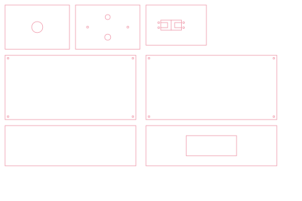

<div dir="auto">
<h1 dir="auto">🇺🇸 / 🇵🇱 C5ISR Tactical Node — Mechanical Enclosure (Rev 1.2)</h1>
</div>

This directory contains the production-ready 2D CAM laser cutting vector profiles and mechanical specifications for the ruggedized, outdoor C5ISR acoustic/optical observation node enclosure.

👉 **[REGISTRATION](https://officina-ferraria.github.io/OFFICINA-FERRARIA/#Rejestracja)**

<details>
<summary>🇵🇱 [Kliknij Trójkąt Po Lewej Stronie Aby Rozwinąć Opis w Języku Polskim]</summary>

<div dir="auto">
<h1 dir="auto">🇵🇱 Węzeł Taktyczny C5ISR — Obudowa Mechaniczna (Rev 1.2)</h1>
</div>
Ten katalog zawiera gotowe do produkcji profile wektorowe CAM 2D do cięcia laserowego oraz specyfikacje mechaniczne dla wzmocnionej, zewnętrznej obudowy węzła obserwacji akustyczno-optycznej C5ISR.
<br><br>

👉 **[REJESTRACJA](https://officina-ferraria.github.io/OFFICINA-FERRARIA/#Rejestracja)**

</details>

---

<div dir="auto">
<h2 dir="auto">🇺🇸 / 🇵🇱 Hardware Components & Financial Transparency / Zamówione Podzespoły i Transparentność Finansowa</h2>
</div>

The core hardware components for this node have been successfully ordered and paid for. For full transparency, the raw PDF confirmations are available directly in this repository:
- 📄 [Kamami_2026-11-07.pdf](./Kamami_2026-11-07.pdf) - Order confirmation.
- 📄 [statement_202631200044149.pdf](./statement_202631200044149.pdf) - Paysafecard payment statement.

The mechanical enclosure components have been quoted and fabricated by PlasticExpress. For full financial transparency, the manufacturing and transaction documents are available below:
- 📄 [wycena10382.pdf](./wycena10382.pdf) - Laser cutting quote.
- 📄 [FSPE202611266.pdf](./FSPE202611266.pdf) - VAT Invoice from Contra Sp. z o.o.
- 📄 [statement_202631300096025.pdf](./statement_202631300096025.pdf) - Paysafecard payment statement.

<div dir="auto">
<h3 dir="auto">🛒 How to order</h3>
</div>

To automatically add the quoted enclosure components to your cart, click the **ORDER** link below (you must be logged into the PlasticExpress platform first).

👉 **[ORDER ENCLOSURE](https://plasticexpress.pl/wycena/Qb2gM/a)**

> **⚠️ IMPORTANT ORDER NOTE:**
> In the order notes section on the website, you **must** include the link to the updated SVG file:
> 🔗 
>
>```
>https://github.com/OFFICINA-FERRARIA/OFFICINA-FERRARIA/blob/main/hardware/enclosure/C5ISR_Node_Enclosure_FlatPattern_PMMA-4mm_Rev1.2.svg
>```
>
> **Why is this important?**
> - The servo cutout was shifted by 10 mm to align the MG996R drive axis with the M8 rod in the F608 bearing, and 4× M3 servo mounting holes (`49.5 × 10 mm` pitch) were added.
> - Added 4× M3 corner holes to the rear optical wall, enlarged and offset the bottom PG-13.5 gland cutout (`Ø22 mm`), and relocated the upper ePTFE acoustic membrane cutout to the left side wall (`175 mm` from bottom) to align with the top microphone of the Galaxy XCover 5.
> - **Keep offcuts:** Do not discard cutouts from the servo slot (2× U-shaped smartphone retention clips), heatsink window (12× `15 × 15 mm` mandatory structural bonding blocks), or the `120 × 8 mm` strip below the servo shelf (8× `15 × 8 mm` spacer blocks).
<br>

**Project Bill of Materials (BOM) & Costs** (Exchange rates via NBP, 2026-11-23: 1 USD = 4.06 PLN | 1 EUR = 4.46 PLN)

| Qty | Component | Unit Price (PLN) | Total (PLN) | Total (USD) | Total (EUR) |
| :--- | :--- | :--- | :--- | :--- | :--- |
| 1 | [Servo MG996R](https://kamami.pl/serwa-giant/204180-servo-mg996r-5906623440627.html) | 19.54 zł | 19.54 zł | $4.81 | €4.38 |
| 1 | [XIAO ESP32S3 & Wio-SX1262 Kit (Meshtastic/LoRa)](https://kamami.pl/meshtastic/1194474-xiao-esp32s3-wio-sx1262-kit-zestaw-z-modulem-esp32s3-i-komunikacja-lora.html) | 62.16 zł | 62.16 zł | $15.31 | €13.94 |
| 2 | USB-A to USB-C Cable (1m, Black) | 5.08 zł | 10.16 zł | $2.50 | €2.28 |
| 1 | USB-C Adapter M-F (Angled, Side) | 9.16 zł | 9.16 zł | $2.26 | €2.05 |
| 1 | [Laser-cut PMMA Enclosure (PlasticExpress)](https://plasticexpress.pl/wycena/Qb2gM/a) | 71.34 zł | 71.34 zł | $17.57 | €16.00 |
| - | Shipping (Kamami - InPost Paczkomat) | - | 13.90 zł | $3.42 | €3.12 |
| - | Shipping (PlasticExpress - GLS) | - | 20.00 zł | $4.93 | €4.48 |
| **-** | **SUBTOTAL (ELECTRONICS & ENCLOSURE)** | **-** | **206.26 zł** | **$50.80** | **€46.25** |

**Hardware, Fasteners & Assembly Consumables (Castorama — 2026-11-18 & Workshop Stock)**

| Qty | Item | Unit Price (PLN) | Total (PLN) | Total (USD) | Total (EUR) |
| :--- | :--- | :--- | :--- | :--- | :--- |
| 1 | M8 Zinc-Plated Threaded Rod (AZME) | 4.98 zł | 4.98 zł | $1.23 | €1.12 |
| 2 | M8 Self-Locking Hex Nut (DIN 985) | 0.68 zł | 1.36 zł | $0.33 | €0.30 |
| 1 | Cable Gland PG-13.5 (IP68) | 3.98 zł | 3.98 zł | $0.98 | €0.89 |
| 1 | Cable Gland PG-11 (IP68, spare / temporary alignment guide) | 3.48 zł | 3.48 zł | $0.86 | €0.78 |
| 1 | Dragon IPA Cleaner Spray (Isopropanol) | 21.98 zł | 21.98 zł | $5.41 | €4.93 |
| 1 | Dragon Distal 5-min Epoxy Adhesive (6 ml — **25 ml syringe recommended**) | 5.00 zł | 5.00 zł | $1.23 | €1.12 |
| 1 | Painter's Masking Tape (24 mm × 50 m, joint alignment) | 4.98 zł | 4.98 zł | $1.23 | €1.12 |
| 1 set | M3 Brass Hex Standoff Kit (`Aoqdqdqd 120 pcs`: `M3×20+6`, `M3×15+6`, `M3×10`, `M3×20`, `M3×6` screws — workshop stock) | 0.00 zł | 0.00 zł | $0.00 | €0.00 |
| 6 pcs | Steel Nails from Fiber-Optic Cable Clips (for 6-arm servo horn → M8 hex nut coupler — workshop stock) | 0.00 zł | 0.00 zł | $0.00 | €0.00 |
| **-** | **SUBTOTAL (HARDWARE & CONSUMABLES)** | **-** | **45.76 zł** | **$11.27** | **€10.26** |
| **-** | **GRAND TOTAL PAID** | **-** | **252.02 zł** | **$62.07** | **€56.51** |

<details>
<summary>🇵🇱 [Kliknij Trójkąt Po Lewej Stronie Aby Rozwinąć Opis w Języku Polskim]</summary>
<br>

Kluczowe podzespoły sprzętowe dla tego węzła zostały pomyślnie zamówione i opłacone. W ramach pełnej transparentności finansowej projektu, surowe pliki PDF potwierdzające transakcję i wydatki zostały opublikowane bezpośrednio w tym repozytorium:
- 📄 [Kamami_2026-11-07.pdf](./Kamami_2026-11-07.pdf) - Potwierzenie zamówienia.
- 📄 [statement_202631200044149.pdf](./statement_202631200044149.pdf) - Wyciąg płatności z konta Paysafecard.

Elementy mechaniczne obudowy zostały wycenione i wyprodukowane przez PlasticExpress. W ramach pełnej transparentności finansowej, dokumenty produkcyjne i transakcyjne są dostępne poniżej:
- 📄 [wycena10382.pdf](./wycena10382.pdf) - Oferta cięcia laserowego.
- 📄 [FSPE202611266.pdf](./FSPE202611266.pdf) - Faktura VAT (Contra Sp. z o.o.).
- 📄 [statement_202631300096025.pdf](./statement_202631300096025.pdf) - Wyciąg płatności Paysafecard.

<div dir="auto">
<h3 dir="auto">🛒 Jak zamówić</h3>
</div>

Aby automatycznie dodać wycenione elementy obudowy do koszyka, kliknij poniższy przycisk **ZAMÓW** (wymagane jest wcześniejsze zalogowanie na platformie PlasticExpress).

👉 **[ZAMÓW OBUDOWĘ](https://plasticexpress.pl/wycena/Qb2gM/a)**

> **⚠️ WAŻNA UWAGA DO ZAMÓWIENIA:**
> W polu uwag do zamówienia na stronie należy **bezwzględnie załączyć link** do zaktualizowanego pliku SVG:
> 🔗 
>
>```
>https://github.com/OFFICINA-FERRARIA/OFFICINA-FERRARIA/blob/main/hardware/enclosure/C5ISR_Node_Enclosure_FlatPattern_PMMA-4mm_Rev1.2.svg
>```
>
> **Dlaczego to ważne?**
> - Otwór na serwo MG996R został przesunięty o 10 mm, aby oś napędu idealnie zgadzała się z prętem M8 umieszczonym w łożysku F608, oraz dodano 4 otwory montażowe M3 (`49,5 × 10 mm`).
> - Dodano 4 narożne otwory M3 w tylnej ściance optycznej, powiększono i przesunięto otwór dławnicy PG-13,5 (`Ø22 mm`) pod przednią ściankę oraz przeniesiono górną membranę akustyczną ePTFE na lewą ściankę boczną (`175 mm` od dołu) na wysokość górnego mikrofonu Galaxy XCover 5.
> - **Zachowanie odpadów:** Prośba o niewyrzucanie wyciętych elementów z otworu serwa (2× chwytak U pod smartfon), okna radiatora (12× obowiązkowe kostki konstrukcyjne `15 × 15 mm`) oraz paska `120 × 8 mm` spod półki (8× klocek dystansowy `15 × 8 mm`).

**Zestawienie kosztów podzespołów** (Średni kurs NBP z dn. 2026-11-23: 1 USD = 4,06 PLN | 1 EUR = 4,46 PLN)

| Ilość | Podzespół | Cena jedn. (PLN) | Suma (PLN) | Suma (USD) | Suma (EUR) |
| :--- | :--- | :--- | :--- | :--- | :--- |
| 1 | [Serwo MG996R](https://kamami.pl/serwa-giant/204180-servo-mg996r-5906623440627.html) | 19,54 zł | 19,54 zł | $4.81 | €4.38 |
| 1 | [Zestaw XIAO ESP32S3 & Wio-SX1262 Kit (Meshtastic/LoRa)](https://kamami.pl/meshtastic/1194474-xiao-esp32s3-wio-sx1262-kit-zestaw-z-modulem-esp32s3-i-komunikacja-lora.html) | 62,16 zł | 62,16 zł | $15.31 | €13.94 |
| 2 | Przewód USB typ A - USB typ C (1m, czarny) | 5,08 zł | 10,16 zł | $2.50 | €2.28 |
| 1 | Adapter USB typu C M-F (kątowy boczny) | 9,16 zł | 9,16 zł | $2.26 | €2.05 |
| 1 | [Obudowa PMMA cięta laserowo (PlasticExpress)](https://plasticexpress.pl/wycena/Qb2gM/a) | 71,34 zł | 71,34 zł | $17.57 | €16.00 |
| - | Wysyłka (Kamami - Paczkomat InPost) | - | 13,90 zł | $3.42 | €3.12 |
| - | Wysyłka (PlasticExpress - Kurier GLS) | - | 20,00 zł | $4.93 | €4.48 |
| **-** | **SUMA CZĘŚCIOWA (ELEKTRONIKA I OBUDOWA)** | **-** | **206,26 zł** | **$50.80** | **€46.25** |

**Elementy złączne i chemia montażowa (Castorama — 2026-11-18 oraz zapas warsztatowy)**

| Ilość | Pozycja | Cena jedn. (PLN) | Suma (PLN) | Suma (USD) | Suma (EUR) |
| :--- | :--- | :--- | :--- | :--- | :--- |
| 1 | Pręt gwintowany ocynkowany M8 (AZME) | 4,98 zł | 4,98 zł | $1.23 | €1.12 |
| 2 | Nakrętka sześciokątna M8 samohamowna (DIN 985) | 0,68 zł | 1,36 zł | $0.33 | €0.30 |
| 1 | Dławik kablowy z gwintem PG-13,5 (IP68) | 3,98 zł | 3,98 zł | $0.98 | €0.89 |
| 1 | Dławik kablowy z gwintem PG-11 (IP68, zapas / tymczasowa prowadnica osi) | 3,48 zł | 3,48 zł | $0.86 | €0.78 |
| 1 | Dragon IPA Cleaner Spray (izopropanol do odtłuszczania) | 21,98 zł | 21,98 zł | $5.41 | €4.93 |
| 1 | Klej epoksydowy Dragon Distal 5 min (6 ml — **zalecana strzykawka 25 ml**) | 5,00 zł | 5,00 zł | $1.23 | €1.12 |
| 1 | Taśma malarska 24 mm × 50 m (pozycjonowanie ścianek) | 4,98 zł | 4,98 zł | $1.23 | €1.12 |
| 1 kpl. | Zestaw mosiężnych tulei dystansowych M3 (`Aoqdqdqd 120 szt.`: `M3×20+6`, `M3×15+6`, `M3×10`, `M3×20`, śruby `M3×6` — zapas własny) | 0,00 zł | 0,00 zł | $0.00 | €0.00 |
| 6 szt. | Gwoździki z uchwytów do przewodów światłowodowych (blokada nakrętki M8 w 6-ramiennym orczyku — zapas własny) | 0,00 zł | 0,00 zł | $0.00 | €0.00 |
| **-** | **SUMA CZĘŚCIOWA (ELEMENTY ZŁĄCZNE I CHEMIA)** | **-** | **45,76 zł** | **$11.27** | **€10.26** |
| **-** | **ZAPŁACONO W SUMIE** | **-** | **252,02 zł** | **$62.07** | **€56.51** |

</details>

---

<div dir="auto">
<h2 dir="auto">🇺🇸 / 🇵🇱 1. Manufacturing Profile Overview / Przegląd Profilu Produkcyjnego</h2>
</div>



-   **Source File:** `C5ISR_Node_Enclosure_FlatPattern_PMMA-4mm_Rev1.2.svg`
-   **Scale:** 1:1 (True Metric, Millimeters)
-   **Cutting Process:** Industrial CO2 / Fiber Laser CNC
-   **Target Hardware Compatibility:** Samsung Galaxy XCover 5 (Strict tolerance for dual-camera optical shroud alignment, top microphone acoustic port, and 10 mm slide-in retention clips)

<details>
<summary>🇵🇱 [Kliknij Trójkąt Po Lewej Stronie Aby Rozwinąć Opis w Języku Polskim]</summary>
<br>

-   **Plik Źródłowy:** `C5ISR_Node_Enclosure_FlatPattern_PMMA-4mm_Rev1.2.svg`
-   **Skala:** 1:1 (Rzeczywiste wymiary metryczne, milimetry)
-   **Proces Cięcia:** Przemysłowy laser CNC CO2 / Fiber
-   **Kompatybilność Sprzętowa:** Samsung Galaxy XCover 5 (Ścisła tolerancja dla osłony optycznej podwójnego aparatu, portu akustycznego górnego mikrofonu oraz wsuwanych uchwytów 10 mm)

</details>

---

<div dir="auto">
<h2 dir="auto">🇺🇸 / 🇵🇱 2. Material Specifications & Fabrication Notes / Specyfikacja Materiałowa</h2>
</div>

| Parameter | Specification | Notes |
| :--- | :--- | :--- |
| **Material** | PMMA GS (Cast Acrylic / Plexiglas) | **Cast only.** Do not substitute with extruded (XT) acrylic due to chemical solvent crazing and thermal stress cracking. |
| **Sheet Thickness** | 4.0 mm ($\pm 0.3$ mm tolerance) | Structural walls, top/bottom bulkheads, internal servo partition shelf, and laser-cut offcut clips/blocks. |
| **Color / Finish** | Optically clear (high transmission) | Ensures unhindered optical path for primary (East-facing) and front (West-facing) image sensors. |
| **Kerf Compensation** | Nominal: 0.15 – 0.20 mm | Integrated in vector stroke paths; smartphone retention clips include +0.8 mm nominal clearance (10.0 mm slot for 9.2 mm device thickness). |

<details>
<summary>🇵🇱 [Kliknij Trójkąt Po Lewej Stronie Aby Rozwinąć Opis w Języku Polskim]</summary>
<br>

| Parametr | Specyfikacja | Uwagi |
| :--- | :--- | :--- |
| **Materiał** | PMMA GS (Szkło akrylowe wylewane / Plexiglas) | **Tylko wylewane.** Nie zastępować akrylem wytłaczanym (XT) ze względu na ryzyko mikropęknięć od rozpuszczalników i naprężeń termicznych. |
| **Grubość Arkusza** | 4,0 mm (tolerancja $\pm 0,3$ mm) | Ściany konstrukcyjne, górne/dolne grodzie, wewnętrzna półka na serwo oraz chwytaki i klocki wycinane z odpadów. |
| **Kolor / Wykończenie** | Optycznie przezroczysty (wysoka transmisja) | Zapewnia niezakłóconą ścieżkę optyczną dla głównego aparatu (sektor wschodni) oraz przedniej kamery (sektor zachodni). |
| **Kompensacja Rzazu** | Nominalnie: 0,15 – 0,20 mm | Zintegrowana w ścieżkach wektorowych; chwytaki smartfona uwzględniają +0,8 mm luzu nominalnego (szczelina 10,0 mm dla grubości telefonu 9,2 mm). |

</details>

---

<div dir="auto">
<h2 dir="auto">🇺🇸 / 🇵🇱 3. Mechanical Interface & Features / Interfejs Mechaniczny</h2>
</div>

-   **Primary Suspension (Top Plate):** Center cut-out (`Ø22 mm`) designed for an integrated F608 flanged bearing carrying an M8 structural threaded rod / dynamic pivot axis. *(Note: During initial bench prototyping prior to F608 bearing delivery, IP68 cable glands were utilized strictly as temporary axial alignment guides to stabilize the M8 rod.)*
-   **Zero-Backlash Servo-to-M8 Shaft Coupling (6-Arm Horn + Hex Nut):** The MG996R servo uses its standard **6-arm horn** paired directly with a standard **M8 hex nut** (6 flat faces) threaded onto the M8 rod and locked with a counter-nut. Six steel nails salvaged from fiber-optic cable clips are press-fitted tightly into the inner holes of all 6 horn arms — each nail braces flush against one of the 6 flat faces of the M8 nut, forming a rigid, zero-backlash mechanical torque coupler without requiring a custom machined adapter.
-   **Internal Drive Partition & Smartphone Retention:** Direct cut-out for MG996R metal-gear servo with 4× M3 mounting holes (`49.5 × 10 mm` pitch). Two U-shaped retention clips (`20 × 20.5 mm`, `10 × 13.5 mm` slot) cut from the servo slot offcut are bonded under the servo body to slide onto the top edge of the smartphone.


<br>
Super Source: https://make.net.za/product/mg996r-servo-motor-analog-180-degrees

-   **Thermal Management:** Right side wall cut-out (`100 × 40 mm`) sized for a passively cooled, finned extruded aluminum heatsink interface.
-   **Acoustic & Environmental Ports:**
  -   **Bottom ePTFE membrane (`Ø10 mm`):** Offset pressure-equalization and vapor-permeable vent on the bottom bulkhead.
  -   **Upper ePTFE acoustic port (`Ø10 mm`):** Centered on the left side wall (`175 mm` from bottom / `85 mm` from top) directly at the height of the Galaxy XCover 5 top microphone for omnidirectional East/West acoustic detection while shielding against frontal wind noise.
  -   **Bottom USB-C Pedestal, LoRa Bay & PG-13.5 Cable Gland (`Ø22 mm`):** The `Ø22 mm` disc offcut from the F608 bearing hole is bonded centrally (`214, 54`) on the bottom bulkhead as a rigid pedestal for the side-angled USB-C adapter, while the `PG-13.5` IP68 cable gland port is offset toward the front edge (`cy = 79.5`) for strain-relieved umbilical routing. The `XIAO ESP32S3 & Wio-SX1262` kit sits on a foam vibration isolator in the lower-left bay with its antenna adhered to the inner left wall, clear of the optical path.
-   **Center-of-Gravity (CoG) Ballast Attachment:** Dual bottom-corner anchor points for M4/M5 eye bolts and carabiner rigging, carrying an external counterweight tactical battery pouch.

<details>
<summary>🇵🇱 [Kliknij Trójkąt Po Lewej Stronie Aby Rozwinąć Opis w Języku Polskim]</summary>
<br>

-   **Główne Zawieszenie (Górna Płyta):** Środkowe wycięcie (`Ø22 mm`) zaprojektowane dla zintegrowanego łożyska kołnierzowego F608 opierającego pręt gwintowany M8 / dynamiczną oś obrotu. *(Uwaga prototypowa: na etapie montażu wstępnego — w oczekiwaniu na dostawę docelowego łożyska F608 — dławiki kablowe zostały użyte wyłącznie jako tymczasowe prowadnice centrujące i stabilizujące pręt M8.)*
-   **Bezluzowe Sprzęgło Serwo → Oś M8 (Orczyk 6-ramienny + Nakrętka M8):** Na serwie MG996R zastosowano standardowy **orczyk sześcioramienny** współpracujący bezpośrednio z **nakrętką sześciokątną M8** (6 płaskich ścianek) skontrowaną na pręcie M8. W wewnętrzne otwory wszystkich 6 ramion orczyka wciśnięto na ciasno stalowe gwoździki pozyskane z uchwytów do przewodów światłowodowych — każdy z 6 gwoździków opiera się płasko o jedną z 6 ścianek nakrętki M8, tworząc sztywne, bezluzowe sprzęgło kształtowe bez konieczności dorabiania toczonych redukcji.
-   **Wewnętrzna Przegroda Napędowa i Chwytaki Smartfona:** Wycięcie pod serwo MG996R z metalową przekładnią wraz z 4 otworami montażowymi M3 (`49,5 × 10 mm`). Z odpadu wyciętego z gniazda serwa powstają dwa chwytaki w kształcie litery U (`20 × 20,5 mm`, szczelina `10 × 13,5 mm`), klejone pod spodem serwa i wsuwane od góry na krawędź smartfona.


<br>
Super Source: https://make.net.za/product/mg996r-servo-motor-analog-180-degrees

-   **Zarządzanie Termiczne:** Wycięcie w prawej bocznej ściance (`100 × 40 mm`) dostosowane pod pasywnie chłodzony radiator z tłoczonego aluminium.
-   **Porty Akustyczne i Środowiskowe:**
  -   **Dolna membrana ePTFE (`Ø10 mm`):** Asymetryczny zawór wyrównujący ciśnienie i przepuszczający parę wodną w dolnym deklu.
  -   **Górny port akustyczny ePTFE (`Ø10 mm`):** Umieszczony centralnie w osi lewej ścianki bocznej (`175 mm` od dołu / `85 mm` od góry) dokładnie na wysokości górnego mikrofonu Galaxy XCover 5 — zapewnia równomierny nasłuch w sektorze wschodnim i zachodnim przy jednoczesnej ochronie przed szumem czołowego wiatru.
  -   **Dolna baza USB-C, wnęka LoRa i dławnica PG-13,5 (`Ø22 mm`):** Wycięty krążek `Ø22 mm` z otworu pod łożysko F608 jest wklejony centralnie (`214, 54`) w dolny dekiel jako podstawa pod kątowy adapter USB-C, natomiast otwór dławnicy kablowej `PG-13,5` (IP68) został przesunięty w stronę przedniej ścianki (`cy = 79.5`). Zestaw `XIAO ESP32S3 & Wio-SX1262` osadzono na piance wibroizolacyjnej w lewym dolnym narożniku z anteną przyklejoną do wewnętrznej powierzchni lewej ścianki, poza polem widzenia kamer.
-   **Balast Środka Ciężkości (CoG):** Dwa dolne punkty kotwiczące pod śruby z uchem M4/M5 i karabińczyki, przenoszące zewnętrzną taktyczną kieszeń na powerbank stanowiącą przeciwwagę.

</details>

---

<div dir="auto">
<h2 dir="auto">🇺🇸 / 🇵🇱 4. Assembly & Joining Procedures / Procedury Montażu</h2>
</div>

1.  **Edge Preparation:** Remove protective masking along joint interfaces. Degrease all bonding faces with isopropanol (`Dragon IPA Cleaner Spray`) and pre-align perpendicular walls using 24 mm painter's masking tape.
2.  **Mandatory Offcut Bonding Blocks (6 Top + 6 Bottom):** All 12× laser-cut PMMA squares (`15 × 15 mm` from the heatsink window) are mandatory structural elements. Bond them in sets of **6 on the top lid** and **6 on the bottom lid** (3 evenly spaced along each long edge) using 2-component 5-minute epoxy adhesive (`Dragon Distal`, 25 ml syringe recommended). These blocks dramatically increase the epoxy joint surface area and create rigid mechanical seats against which the corner standoffs brace.
3.  **Internal M3 Brass Standoff Frame (80 mm Span):** Assemble the 4 corner tie-rods using standard **M3 brass hex standoffs (`Aoqdqdqd 120 pcs` kit)** stacked in series to match the exact **80 mm** internal width of the side walls (e.g., `2× M3×20+6 mm` + `2× M3×15+6 mm` + `1× M3×10 mm` = `80 mm` per corner, or `3× M3×20+6 mm` + `1× M3×20 mm`), secured at both ends with **8× M3×6 mm screws**. Resting directly against the bonded `15 × 15 mm` lid blocks, this rigid internal skeleton squares the entire enclosure during adhesive curing and allows tool-assisted removal of both the front service hatch and the rear optical wall without gluing corner blocks or heat-set inserts. *(The 8× `15 × 8 mm` offcut blocks cut below the servo shelf remain available as optional internal spacers.)*

<details>
<summary>🇵🇱 [Kliknij Trójkąt Po Lewej Stronie Aby Rozwinąć Opis w Języku Polskim]</summary>
<br>

1.  **Przygotowanie Krawędzi:** Usuń folię ochronną wzdłuż powierzchni łączeń. Odtłuść wszystkie powierzchnie klejenia izopropanolem (`Dragon IPA Cleaner Spray`) i spozycjonuj prostopadłe ścianki za pomocą taśmy malarskiej 24 mm.
2.  **Obowiązkowe Klocki Wiążące z Odpadów (6 Góra + 6 Dół):** Wszystkie 12× wyciętych kwadratów PMMA (`15 × 15 mm` z okna radiatora) stanowi obowiązkowy element konstrukcyjny. Należy je wkleić po **6 sztuk na górnym deklu** i **6 sztuk na dolnym deklu** (po 3 równomiernie rozłożone wzdłuż dłuższych krawędzi) za pomocą dwuskładnikowego kleju epoksydowego 5 min (`Dragon Distal`, zalecana strzykawka 25 ml). Klocki te wielokrotnie zwiększają powierzchnię spoiny klejowej oraz tworzą sztywne punkty oporu dla narożnych dystansów.
3.  **Wewnętrzny Szkielet z Mosiężnych Dystansów M3 (rozstaw 80 mm):** Skręć 4 narożne przeloty z **mosiężnych tulei dystansowych M3 (zestaw `Aoqdqdqd 120 szt.`)**, łącząc je szeregowo na dokładną szerokość wewnętrzną ścianek bocznych **80 mm** (np. `2× M3×20+6 mm` + `2× M3×15+6 mm` + `1× M3×10 mm` = `80 mm` na narożnik lub `3× M3×20+6 mm` + `1× M3×20 mm`) i domykając z obu stron **8× śrubami M3×6 mm**. Dystanse zapierają się bezpośrednio o wklejone w dekle kwadraty `15 × 15 mm`, tworząc sztywny szkielet pozycjonujący obudowę na czas wiązania kleju i umożliwiający pełny demontaż przedniej klapy rewizyjnej oraz tylnej ścianki optycznej bez konieczności wtapiania gwintów. *(Dodatkowe 8× klocków `15 × 8 mm` wyciętych spod półki serwa służy jako opcjonalne dystanse wewnętrzne.)*

</details>

---

<div dir="auto">
<h2 dir="auto">🇺🇸 / 🇵🇱 5. Raw Vector Data (`.svg`)</h2>
</div>

```svg
<svg xmlns="http://www.w3.org/2000/svg" width="600mm" height="400mm" viewBox="0 0 600 400">
  <g stroke="#dc143c" stroke-width="0.5" fill="none">
    
    <!-- 1. DEKIEL GÓRNY (128x88 mm) -->
    <rect x="10" y="10" width="128" height="88" />
    <circle cx="74" cy="54" r="11" stroke="#dc143c" /> <!-- Otwór na łożysko F608 -->

    <!-- 2. DEKIEL DOLNY (128x88 mm) -->
    <rect x="150" y="10" width="128" height="88" />
    <circle cx="174" cy="54" r="2" stroke="#dc143c" /> <!-- Lewy otwór na hak M4 -->
    <circle cx="254" cy="54" r="2" stroke="#dc143c" /> <!-- Prawy otwór na hak M4 -->
    <circle cx="214" cy="34" r="5" stroke="#dc143c" /> <!-- Dolna membrana ePTFE -->
    <circle cx="214" cy="79.5" r="11" stroke="#dc143c" /> <!-- Przepust kablowy / Dławnica PG-13,5 -->

    <!-- 3. WEWNĘTRZNA PÓŁKA NOŚNA NA SERWO (120x80 mm) -->
    <rect x="290" y="10" width="120" height="80" />
    <rect x="319.5" y="40" width="41" height="20" stroke="#dc143c" /> <!-- Wycięcie na serwo MG996R -->
    <circle cx="315.25" cy="45" r="1.75" stroke="#dc143c" /> <!-- Otwory M3 pod serwo (rozstaw 49.5 x 10 mm) -->
    <circle cx="315.25" cy="55" r="1.75" stroke="#dc143c" />
    <circle cx="364.75" cy="45" r="1.75" stroke="#dc143c" />
    <circle cx="364.75" cy="55" r="1.75" stroke="#dc143c" />
    <!-- UWAGA: Szerokość szczeliny chwytaków (obecnie 10 mm dla Samsung Galaxy XCover 5 o grubości 9,2 mm) jest
    zależna od wybranego modelu smartfona i jego grubości (zalecany luz montażowy +0,8 do +1,0 mm) -->
    <line x1="340" y1="40" x2="340" y2="60" stroke="#dc143c" /> <!-- Podział odpadu na 2 chwytaki (20x20.5 mm) -->
    <path d="M 319.5 45 L 333 45 L 333 55 L 319.5 55" stroke="#dc143c" /> <!-- Chwytak lewy (obrócony 90°): szczelina 10x13.5 mm -->
    <path d="M 360.5 45 L 347 45 L 347 55 L 360.5 55" stroke="#dc143c" /> <!-- Chwytak prawy (obrócony 90°): szczelina 10x13.5 mm -->

    <!-- Pasek 120x8 mm pod półką (8 klocków 15x8 mm, wspólne linie cięcia, odsunięty po 6 mm od półki i pleców) -->
    <line x1="305" y1="96" x2="305" y2="104" stroke="#dc143c" />
    <line x1="320" y1="96" x2="320" y2="104" stroke="#dc143c" />
    <line x1="335" y1="96" x2="335" y2="104" stroke="#dc143c" />
    <line x1="350" y1="96" x2="350" y2="104" stroke="#dc143c" />
    <line x1="365" y1="96" x2="365" y2="104" stroke="#dc143c" />
    <line x1="380" y1="96" x2="380" y2="104" stroke="#dc143c" />
    <line x1="395" y1="96" x2="395" y2="104" stroke="#dc143c" />
    <rect x="290" y="96" width="120" height="8" stroke="#dc143c" />

    <!-- 4. FASADA FRONTOWA / KLAPA REWIZYJNA (260x128 mm) -->
    <rect x="10" y="110" width="260" height="128" />
    <circle cx="16" cy="116" r="1.75" stroke="#dc143c" /> <!-- Otwory M3 -->
    <circle cx="264" cy="116" r="1.75" stroke="#dc143c" />
    <circle cx="16" cy="232" r="1.75" stroke="#dc143c" />
    <circle cx="264" cy="232" r="1.75" stroke="#dc143c" />

    <!-- 5. ŚCIANKA TYLNA (260x128 mm) -->
    <rect x="290" y="110" width="260" height="128" />
    <circle cx="296" cy="116" r="1.75" stroke="#dc143c" /> <!-- Otwory M3 -->
    <circle cx="544" cy="116" r="1.75" stroke="#dc143c" />
    <circle cx="296" cy="232" r="1.75" stroke="#dc143c" />
    <circle cx="544" cy="232" r="1.75" stroke="#dc143c" />

    <!-- 6. ŚCIANKA BOCZNA LEWA Z MEMBRANĄ ePTFE (260x80 mm) -->
    <rect x="10" y="250" width="260" height="80" />
    <circle cx="185" cy="290" r="5" stroke="#dc143c" /> <!-- Górna membrana ePTFE (175 mm od dołu / 85 mm od góry, centralnie w osi ścianki — na wysokości górnego mikrofonu XCover 5) -->

    <!-- 7. ŚCIANKA BOCZNA PRAWA Z RADIATOREM (260x80 mm) -->
    <rect x="290" y="250" width="260" height="80" />
    <rect x="370" y="270" width="100" height="40" stroke="#dc143c" /> <!-- Wycięcie na radiator -->
    <!-- Siatka 6x2 = 12 kwadracików 15x15 mm (wspólne linie cięcia, ramka 5 mm) -->
    <line x1="390" y1="275" x2="390" y2="305" stroke="#dc143c" />
    <line x1="405" y1="275" x2="405" y2="305" stroke="#dc143c" />
    <line x1="420" y1="275" x2="420" y2="305" stroke="#dc143c" />
    <line x1="435" y1="275" x2="435" y2="305" stroke="#dc143c" />
    <line x1="450" y1="275" x2="450" y2="305" stroke="#dc143c" />
    <line x1="375" y1="290" x2="465" y2="290" stroke="#dc143c" />
    <rect x="375" y="275" width="90" height="30" stroke="#dc143c" />

  </g>
</svg>
```